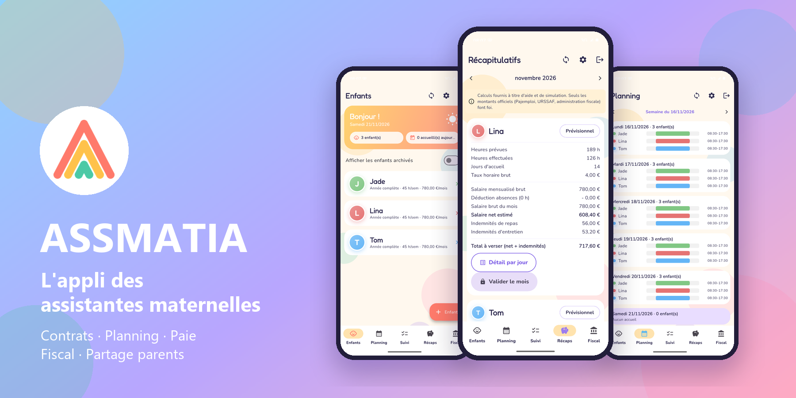
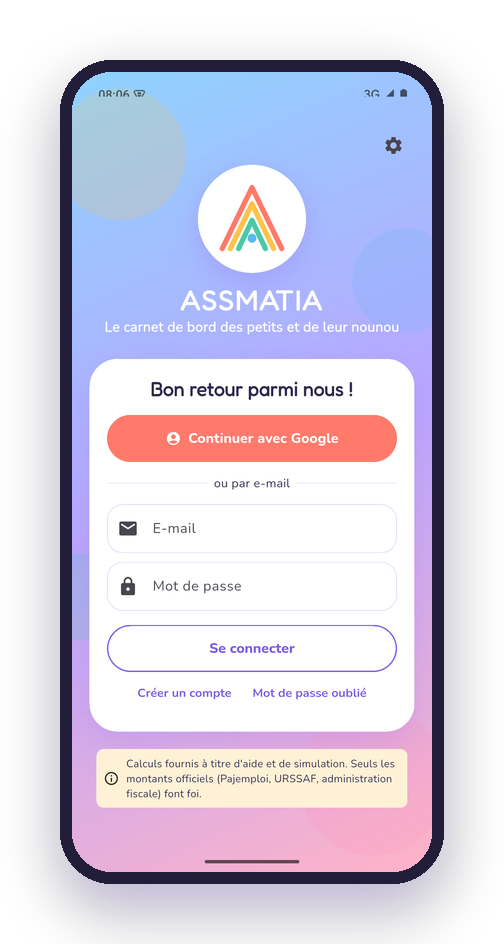
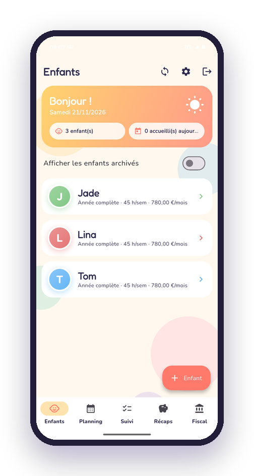
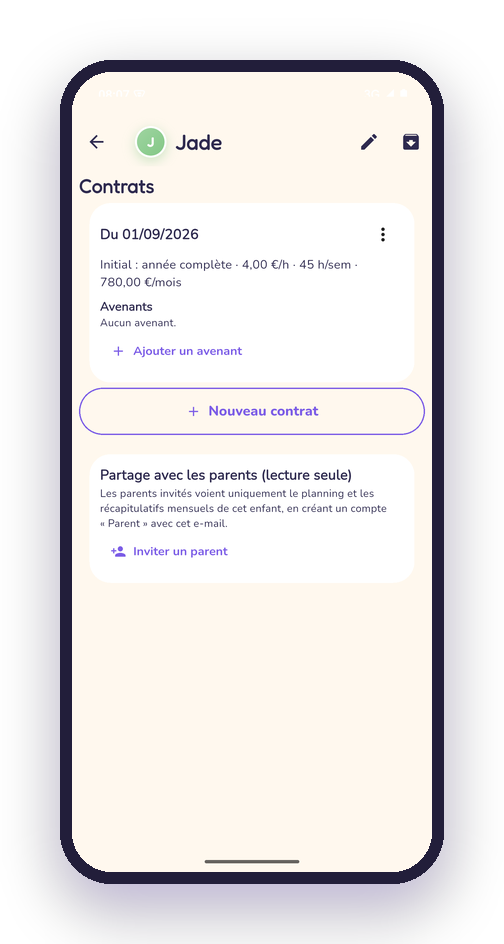
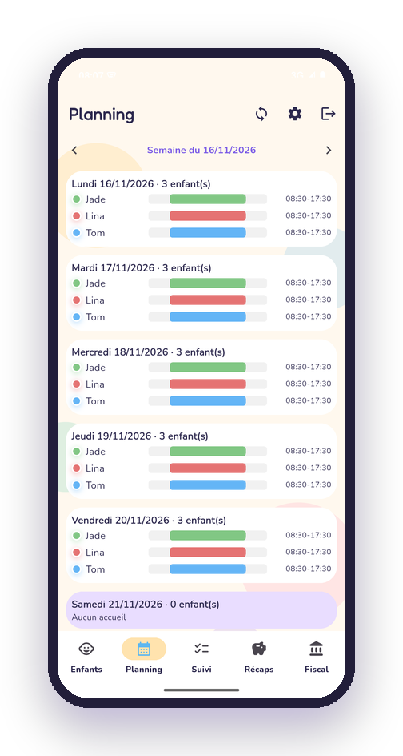
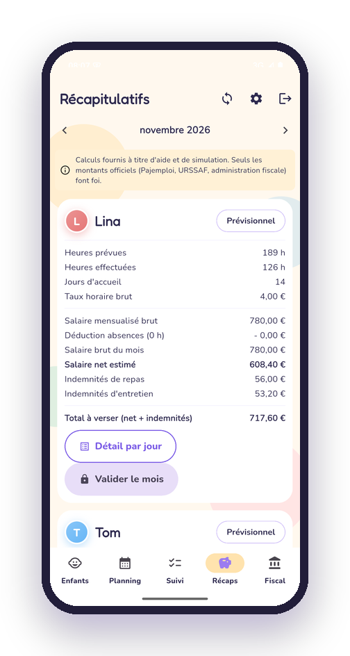
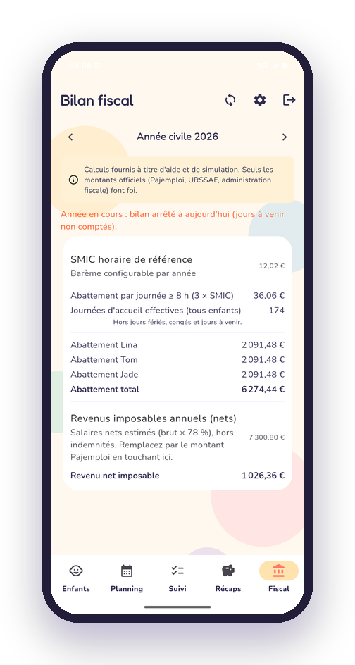

<p align="center">
  
</p>

<h1 align="center">ASSMATIA</h1>

<p align="center">
  <b>Toute la gestion d'une assistante maternelle, dans la poche.</b><br>
  Contrats, avenants, planning, suivi du jour, paie, congés payés et déclaration fiscale :<br>
  calculés automatiquement, partagés en lecture seule avec les parents.
</p>

<p align="center">
  
  
  
  
  
</p>

<p align="center">
  <a href="https://github.com/Jonathanmx5/assmatia-releases/releases/latest"><b>⬇️ Télécharger l'APK Android</b></a>
</p>

---

## Pourquoi ASSMATIA ?

Une assistante maternelle jongle chaque mois avec des mensualisations, des absences à déduire, des indemnités
d'entretien, des avenants et, une fois par an, un abattement fiscal à calculer jour par jour. Le tout souvent
sur un tableur ou un carnet.

**ASSMATIA fait ces calculs à sa place**, pour tous les enfants à la fois, et les parents consultent
le planning et le récapitulatif de leur enfant depuis leur propre téléphone, sans pouvoir rien modifier.

| ⏱️ Gain de temps | 🧮 Calculs fiables | 👨‍👩‍👧 Parents informés | 🔒 Données protégées |
|:---:|:---:|:---:|:---:|
| Le mois se boucle en quelques touches | Mensualisation, Cour de cassation, abattement fiscal | Planning et récaps partagés en temps réel | Lecture seule, accès limité à leur enfant |

## L'app en images

<table>
  <tr>
    <td align="center"><br><b>Connexion</b><br>Compte Google ou e-mail</td>
    <td align="center"><br><b>Accueil</b><br>Les enfants accueillis d'un coup d'œil</td>
    <td align="center"><br><b>Fiche enfant</b><br>Contrats, avenants, partage parents</td>
  </tr>
  <tr>
    <td align="center"><br><b>Planning</b><br>La semaine de tous les enfants</td>
    <td align="center"><br><b>Récapitulatif mensuel</b><br>Salaire, déductions, indemnités</td>
    <td align="center"><br><b>Bilan fiscal</b><br>Abattement annuel automatique</td>
  </tr>
</table>

## Fonctionnalités

### 👶 Enfants et contrats
- Fiche par enfant avec sa couleur, archivage des anciens accueils.
- Contrats en **année complète** ou **année incomplète**.
- **Avenants datés** : une augmentation au 1er novembre ne touche pas aux mois précédents.
- Contrôles automatiques : contrats qui se chevauchent, horaires incohérents.

### 📅 Planning et suivi du jour
- Planning de la semaine pour tous les enfants, avec les **jours fériés** et les **congés**.
- Pointage en un geste : « Tous présents », horaires réels, absence déduite ou non, absence sur la semaine.
- Indemnités de repas et d'entretien calculées chaque jour, modifiables à la main.

### 💶 Paie
- **Mensualisation** calculée et proratisée en cas d'entrée, de sortie ou d'avenant en cours de mois.
- **Déduction d'absence selon la Cour de cassation**, formule affichée.
- Brut du mois, **net estimé** (taux réglable), total à verser indemnités comprises.
- Détail jour par jour et **validation du mois** : un mois validé ne bouge plus.
- **Congés payés** estimés : 10 % ou maintien de salaire, le plus favorable.

### 🧾 Fiscal
- **Abattement** sur l'année civile, tous enfants confondus : 3 × SMIC par journée de 8 h et plus,
  au prorata en dessous.
- SMIC de référence réglable par année, revenus imposables saisissables (montant Pajemploi).
- Revenu net imposable calculé, jamais négatif.

### 👨‍👩‍👧 Espace parents
- Invitation par e-mail, message prêt à envoyer par SMS ou messagerie.
- Le parent voit **uniquement** le planning et les récapitulatifs de **son** enfant.
- E-mail vérifié obligatoire ; retirer un parent lui retire tout l'historique.

### ⚙️ Confort
- Fonctionne hors connexion, synchronisation au retour du réseau.
- Export et import d'une sauvegarde, suppression du compte et des données.
- **Mises à jour depuis l'app** : l'engrenage signale une nouvelle version et l'installe.

## Les règles de calcul

| Élément | Formule |
|---|---|
| Mensualisation | taux horaire × heures par semaine × semaines (52 en année complète) ÷ 12 |
| Déduction d'absence | salaire mensuel × heures d'absence ÷ heures prévues du mois |
| Indemnité d'entretien | la plus élevée entre le forfait journalier et le montant horaire × heures |
| Abattement fiscal | 8 h et plus : 3 × SMIC ; moins de 8 h : heures ÷ 8 × 3 × SMIC |
| Revenu net imposable | revenus imposables − abattement, plafonné à 0 |

Tous les montants sont arrondis au centime. Les jours fériés sont payés sans accueil, les jours à venir
sont affichés en prévisionnel.

> ⚠️ **Avertissement** : les calculs sont fournis à titre d'aide et de simulation. Seuls les montants officiels
> (Pajemploi, URSSAF, administration fiscale) font foi.

## Installation

1. Téléchargez le dernier APK depuis la page
   [**assmatia-releases**](https://github.com/Jonathanmx5/assmatia-releases/releases/latest).
2. Ouvrez-le sur votre téléphone Android et autorisez l'installation.
3. Connectez-vous avec Google ou un e-mail, puis choisissez **assistante maternelle** ou **parent**.

Les mises à jour suivantes se font depuis l'app (engrenage en haut à droite).

---

## Pour les développeurs

<details>
<summary><b>Architecture</b></summary>

```
lib/
  domain/        modèles et moteur de calcul pur (engine.dart), sans dépendance Flutter
  data/          NannyStore (état), backends Firestore / fichier local, mises à jour
  presentation/  thème « enfance », écrans assistante maternelle, parent, connexion
firestore.rules  sécurité : écriture réservée à l'assistante, lecture parent limitée à son enfant
integration_test tests de bout en bout sur émulateur Android
rules_test/      tests des règles Firestore
```

- **Flutter / Dart** pour Android, Material 3 avec un thème sur mesure (Fredoka, Nunito, palette pastel).
- **Firebase** : Authentication (Google, e-mail) et Cloud Firestore avec cache hors ligne.
- Les parents ne lisent que deux collections publiées (`sharedPlannings`, `monthlySummaries`) ;
  contrats, suivis et données fiscales restent privés.
</details>

<details>
<summary><b>Lancer le projet</b></summary>

Prérequis : Flutter 3.x, Android SDK, Node.js et Firebase CLI.

```bash
flutter pub get
flutter run
```

Pour utiliser un autre projet Firebase : remplacez `android/app/google-services.json` et l'ID client Web
dans `lib/config.dart`, puis déployez les règles avec `firebase deploy --only firestore:rules`.
</details>

<details>
<summary><b>Tests</b></summary>

```bash
flutter test                                # moteur de calcul et couche données (39 tests)
cd rules_test && npm install && npm test    # règles Firestore sur émulateur (9 tests)
```

Bout en bout, sur un émulateur Android et les émulateurs Firebase :

```bash
firebase emulators:start --only auth,firestore --project assmatia-38810 --config firebase.emulators.json
flutter test integration_test/app_test.dart -d emulator-5554 --dart-define=USE_EMULATOR=true
```
</details>

<details>
<summary><b>Publier une mise à jour</b></summary>

1. Augmentez `version: X.Y.Z+N` dans `pubspec.yaml` (N doit croître).
2. Lancez `./publish_update.ps1 -Notes "Ce qui change"`.

Le script compile l'APK, le publie dans les Releases de
[assmatia-releases](https://github.com/Jonathanmx5/assmatia-releases) et met à jour le manifeste
lu par l'app sur Firebase Hosting.

Les visuels de ce README se régénèrent avec `python docs/make_visuals.py`.
</details>

<details>
<summary><b>Hors périmètre de la V1</b></summary>

Paiement ou abonnement, export PDF, notifications push, plannings en alternance (semaine A / B),
majorations (heures supplémentaires, jours fériés travaillés).
</details>
